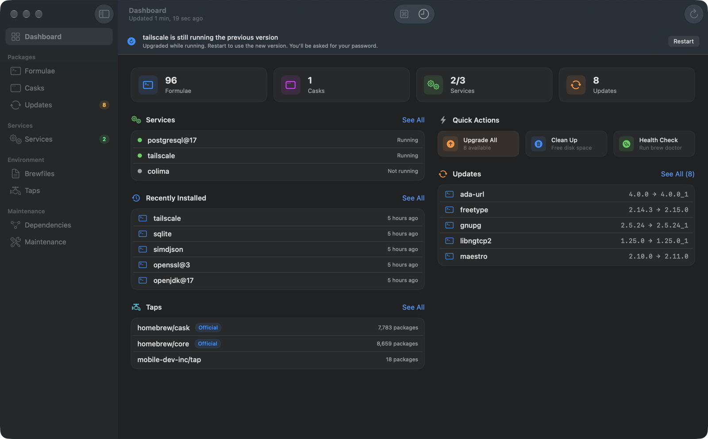
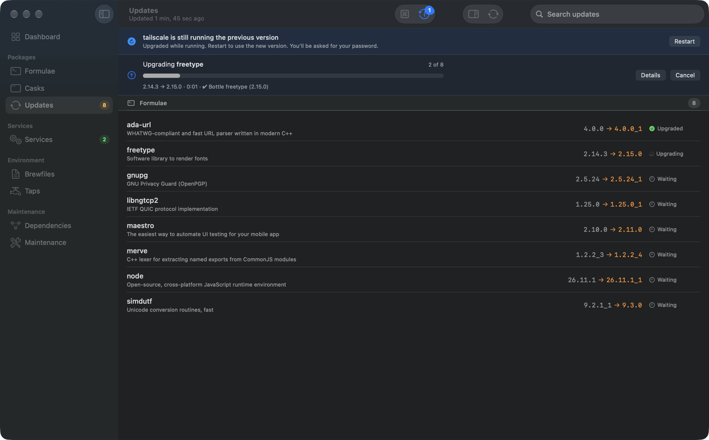
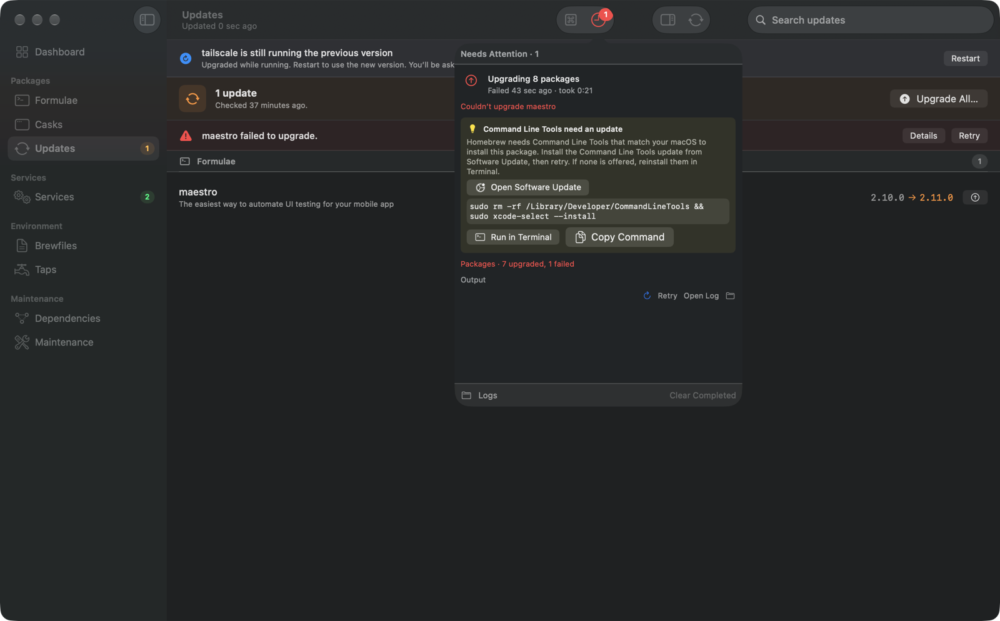
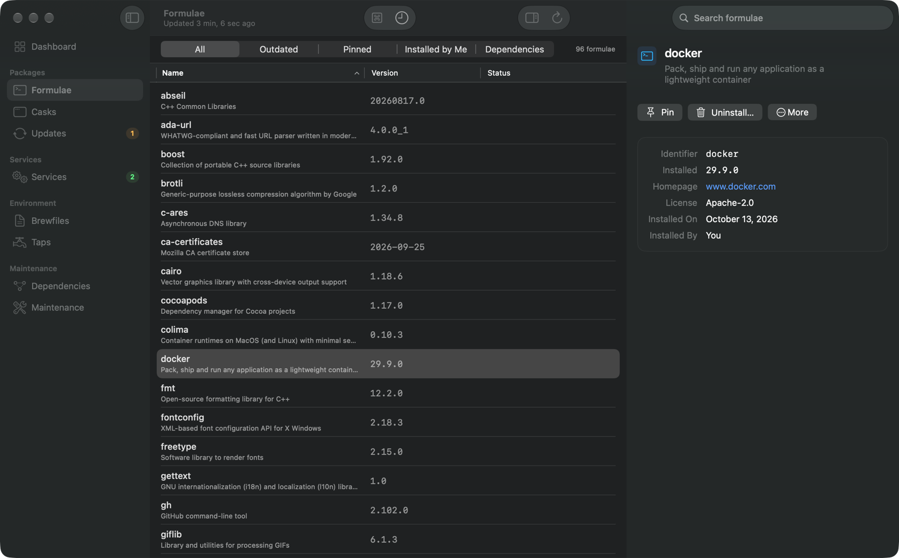
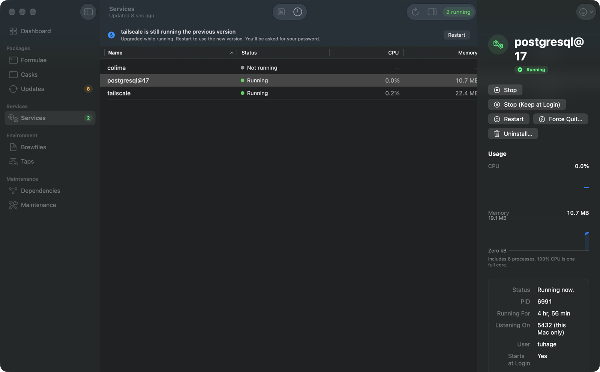
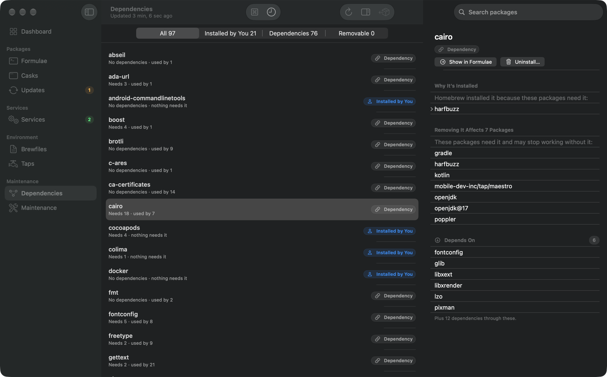
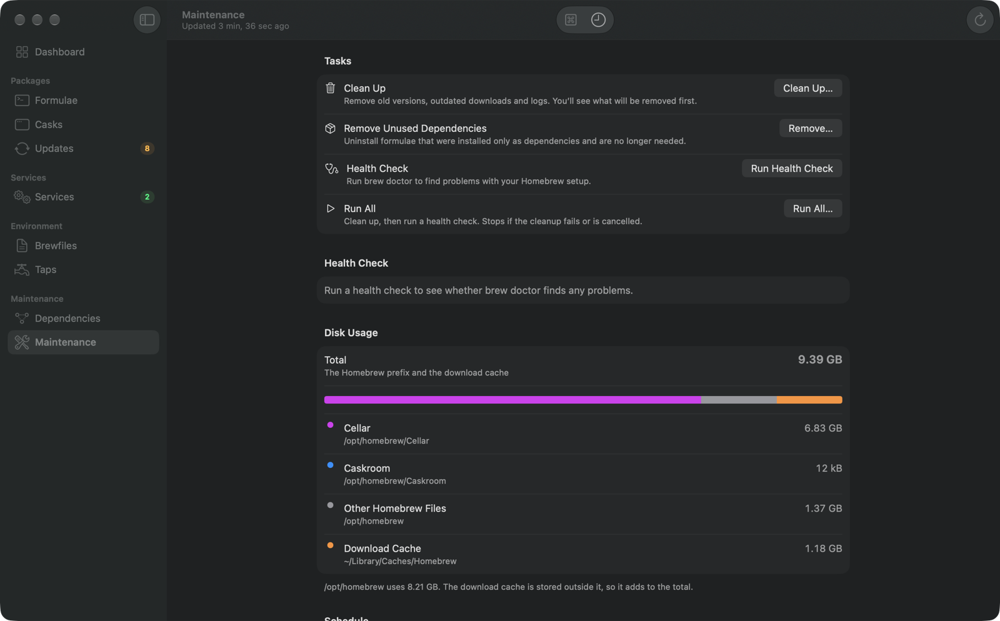

<p align="center">
  
</p>

<h1 align="center">Cellar</h1>

<p align="center">
  <strong>Homebrew, as a Mac app.</strong><br />
  Upgrade, install and clean up packages, run services and keep your setup healthy — without memorizing a single <code>brew</code> flag.
</p>

<p align="center">
  <a href="https://github.com/tuhage/Cellar/releases/latest"></a>
  
  
  
</p>

<p align="center">
  
</p>

---

## Why Cellar

- **See before you change.** Upgrade All, Clean Up and removing unused dependencies show exactly what brew will do — every package, pulled-in dependency and download size — before anything runs.
- **Follow every operation.** Live progress tells you which package is upgrading, how many are left and what brew is doing right now. Cancel any time, retry just what failed, and find every run's full log in `~/Library/Logs/Cellar`.
- **Failures that tell you what to do.** Outdated Command Line Tools, a full disk, no internet or a cask app installed outside Homebrew are recognized and explained, with a button that fixes them.
- **Native and private.** Built with SwiftUI and Apple frameworks only. No account and no telemetry: Cellar talks to `brew` on your Mac and checks GitHub for its own updates.

## Features

### Packages
- Browse installed **formulae and casks**, search Homebrew and install new packages.
- **Updates** lists everything outdated; upgrade one, a selection, or everything at once.
- Select several packages to upgrade or uninstall them together, and pin the ones you want to keep as they are.
- An inspector shows versions, caveats, dependencies and what uses a package, so you know whether it's safe to remove.

### Services
- Start, stop, restart or run a service just once — with CPU and memory use, ports, uptime and logs for each.
- After an upgrade, Cellar offers to restart services still running the old version.
- Services that need root ask for your password once, even for several at a time.

### Environment
- **Brewfiles** — keep a Brewfile per project, see what's missing, install it in one click, or export your current setup. Right-click a folder in Finder and choose *Open in Cellar*.
- **Taps** — see what each tap provides and remove ones you no longer use, safely.
- **Dependencies** — an interactive graph that answers *why is this installed?* and finds dependencies nothing needs anymore.

### Maintenance
- Clean Up and Health Check (`brew doctor`) with a preview and readable findings.
- See how much space Homebrew takes and what can be freed.
- Schedule automatic cleanups, health checks and a daily check for package updates.

### Everywhere on your Mac
- **Activity** — every operation in one place, in a popover or its own window (⇧⌘A). Notifications tell you when long upgrades finish, and progress shows on the Dock icon.
- **Quick Open** (⌘K) — jump to any package, service or page, or run a command.
- **Menu bar** — services and available updates at a glance.
- **Widgets** — small, medium and large widgets for services and updates.
- **Spotlight** — installed packages show up in system search.
- **Command-line tool** — `cellar status`, `cellar start postgresql`, and more.

## Screenshots

| | |
|:-:|:-:|
|  |  |
| **Updates** — follow every package as it upgrades | **Activity** — failures come with a fix |
|  |  |
| **Formulae** — details, caveats and what uses a package | **Services** — control and monitor in one place |
|  |  |
| **Dependencies** — why is this installed? | **Maintenance** — clean up, check health, see disk usage |

## Installation

Install with Homebrew:

```bash
brew install --cask tuhage/cellar/cellar
```

Or download the latest `.dmg` from [Releases](https://github.com/tuhage/Cellar/releases/latest), open it and drag **Cellar** to **Applications**.

Cellar is signed with a Developer ID and notarized by Apple. It checks for its own updates daily and installs them in-app; signed updates are verified before they're installed. You can change this under **Settings › About**.

**Requirements:** macOS 15 or later and [Homebrew](https://brew.sh). If Homebrew isn't installed, Cellar walks you through installing it.

## Command-Line Tool

Homebrew installs it along with the app. Otherwise, install it from **Settings › Extensions**. Then:

```bash
cellar status                 # Packages, services and updates at a glance
cellar list                   # Installed packages
cellar search <query>         # Search Homebrew
cellar start <service>        # Also: stop, restart
cellar health                 # Run brew doctor
cellar cleanup                # Remove old versions and downloads
```

## Keyboard Shortcuts

| Shortcut | Action |
|---|---|
| ⌘K | Quick Open |
| ⇧⌘A | Show Activity |
| ⌘R | Reload |
| ⌥⌘R | Check for Package Updates |
| ⇧⌘U | Upgrade All |
| ⌘U | Upgrade Selected Package |
| ⇧⌘K | Clean Up Homebrew |
| ⇧⌘S | Start or Stop Selected Service |

All shortcuts are listed under **Help › Keyboard Shortcuts**.

## Links

Open Cellar at a specific place with `cellar://` links:

```
cellar://formula/<name>
cellar://cask/<token>
cellar://services                       # any page: dashboard, outdated, maintenance…
cellar://brewfile?path=/path/to/project
```

## Building from Source

```bash
git clone https://github.com/tuhage/Cellar.git
cd Cellar
xcodebuild -project Cellar.xcodeproj -scheme Cellar -configuration Release build -allowProvisioningUpdates
```

Shared models and services live in the `CellarCore` Swift package; run its tests with `cd CellarCore && swift test`.

## License

MIT — see [LICENSE](LICENSE) for details.
